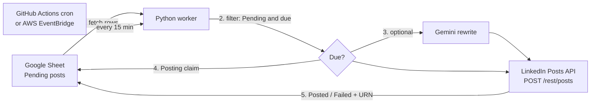

# Automated CMS & Publishing Pipeline

A Google Sheet is the content database. A Python worker runs every 15 minutes, finds posts that are due, publishes them to LinkedIn through the official Posts API, and writes the result back to the sheet. An optional Gemini step rewrites rough notes into polished posts.

## How it works



**Row lifecycle:** `Pending` → `Posting` (claimed, prevents duplicates) → `Posted` or `Failed`. If the token has expired the row returns to `Pending` and the run exits non-zero so you get notified.

## Sheet layout

Import `sample_sheet.csv`, or create these headers in row 1 (the code reads columns A to H):

| A ID | B Post Text | C Scheduled Time | D Status | E Post URN | F AI Rewrite | G Error | H Published Text |
|---|---|---|---|---|---|---|---|

- **Scheduled Time:** `YYYY-MM-DD HH:MM`, interpreted in `TIMEZONE`. Format column C as plain text so Sheets doesn't convert it.
- **Status:** set to `Pending` to queue a post. Columns E, G and H are written by the pipeline.
- **AI Rewrite:** `TRUE` to have Gemini polish the text (needs `GEMINI_API_KEY`).

## Setup

### 1. Google Sheets access
1. Google Cloud Console → new project → enable **Google Sheets API**.
2. Create a **Service Account** → Keys → add JSON key → save as `credentials.json`.
3. Share your sheet with the service account's email as **Editor**.
4. Copy the sheet ID from its URL into `SPREADSHEET_ID`.

### 2. LinkedIn access
1. [LinkedIn Developer Portal](https://developer.linkedin.com) → Create app (attach any Company Page; a placeholder is fine).
2. Products tab: add **Share on LinkedIn** and **Sign In with LinkedIn using OpenID Connect**.
3. Auth tab: add redirect URL `http://localhost:8080/callback`.
4. Run the helper, which prints your token, member URN and expiry date:
   ```bash
   export LINKEDIN_CLIENT_ID=... LINKEDIN_CLIENT_SECRET=...
   python scripts/get_linkedin_token.py
   ```

### 3. Run locally
```bash
python -m venv .venv && source .venv/bin/activate
pip install -r requirements.txt
cp .env.example .env            # fill in values
python -m publisher --dry-run   # shows what would post, changes nothing
python -m publisher             # real run
python -m unittest discover -v  # tests
```

## Deployment

### Option A: GitHub Actions (free, no server)
1. Push to GitHub (`.env` and `credentials.json` are git-ignored).
2. Repo → Settings → Secrets and variables → Actions, add: `SPREADSHEET_ID`, `GOOGLE_CREDENTIALS_JSON` (entire JSON file contents), `LINKEDIN_ACCESS_TOKEN`, `LINKEDIN_PERSON_URN`, `LINKEDIN_TOKEN_EXPIRES_ON`, and optionally `GEMINI_API_KEY`.
3. Run **Publish scheduled posts** manually once with *dry run* on, then let the 15-minute cron take over.
4. A failed run (for example an expired token) triggers GitHub's failure email.

Note: GitHub may delay scheduled workflows by several minutes, and disables scheduled runs on repos with no activity for 60 days.

### Option B: AWS Lambda + EventBridge
1. `./scripts/build_lambda.sh` produces `lambda.zip`. Build on Linux, or use a Lambda-compatible environment, if your machine's architecture differs from Lambda's.
2. Create a Python 3.12 Lambda, upload the zip, and set the handler to `lambda_function.handler`.
3. Add the same variables as environment variables (use `GOOGLE_CREDENTIALS_JSON`; there is no `.env` on Lambda). For production, move secrets into AWS Secrets Manager.
4. Add an EventBridge schedule `rate(15 minutes)`. Set timeout to about 60 s and reserved concurrency to 1.
5. Test with the event `{"dry_run": true}`.

## Design decisions (good interview talking points)

- **Idempotency:** a row is marked `Posting` before the API call, so overlapping runs can't double-post; `concurrency` in the workflow also serialises runs.
- **Failure isolation:** one bad row is marked `Failed` with the error text; the others still publish.
- **Retries with exponential backoff** for 429/5xx/network errors; no retries for 4xx.
- **Token-expiry handling:** 401 stops the run, restores the row to `Pending`, and exits non-zero. A warning is logged 7 days before the expiry date.
- **Dependency injection:** the pipeline takes sheet, LinkedIn and rewriter objects, so it's tested with fakes and needs no network (24 unit tests).
- **Secrets** come only from environment variables; nothing sensitive is committed.
- **Graceful AI fallback:** if Gemini fails, the original text is posted.

## Known limitations and next steps

- Text posts only. Next: images via LinkedIn's Images API.
- LinkedIn's access token lasts about 60 days. A full refresh-token/re-auth flow is a natural v2 feature.
- Reserved characters in post text are escaped automatically; verify odd formatting against LinkedIn's docs if a post renders unexpectedly.
- `LINKEDIN_VERSION` and `GEMINI_MODEL` are configurable because both vendors retire old values. Review them periodically.
- A row stuck in `Posting` (a crash mid-run) is deliberately not retried automatically, to avoid duplicates. Check LinkedIn, then reset it manually.
- Ideas: X/Instagram adapters behind a common `Publisher` interface, Slack/email alerts, a small dashboard.

## Resume bullets

- Built an automated content publishing pipeline (Python, Google Sheets API, LinkedIn Posts API) that publishes scheduled posts with idempotent state tracking, retries with backoff, and token-expiry alerting.
- Deployed on a 15-minute cron via GitHub Actions (also packaged for AWS Lambda + EventBridge) with CI running 24 unit tests on every push.
- Integrated Gemini to rewrite draft notes into LinkedIn-ready posts, with graceful fallback on failure.
